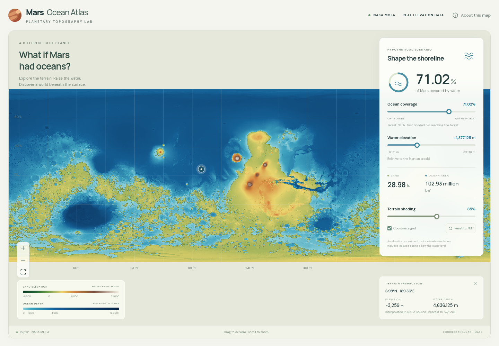

# Mars Ocean Atlas

A statically deployable Next.js / React / TypeScript atlas of real NASA MOLA elevation, with GPU topographic coloring, four-direction hillshade, and hypothetical area-weighted oceans. All source NASA products remain untouched. The starting audit is [MOLA_DATASET_AUDIT.md](MOLA_DATASET_AUDIT.md).

## Run locally

```bash
npm ci
npm run dev
```

Open **http://127.0.0.1:3001**. Port 3001 avoids an existing service on port 3000. The precomputed browser assets in `public/data/` are included in Git. A clone works without the original NASA dataset, Python, or regeneration. Raw NASA data, intermediate derived rasters, dependencies, and caches remain excluded by `.gitignore`. Use Node 24 (see `.nvmrc`).

For a production static export and local preview:

```bash
npm run build
npm start
```

The export is in `out/`; `npm start` serves those static files locally. The existing Vercel deployment uses the same static hosting architecture. There is no elevation server dependency: static hosting serves precomputed tiles and binary lookup chunks. See [exact GitHub and Vercel publishing instructions](docs/DEPLOYMENT.md). The optional Google Fonts CSS falls back to system fonts when offline.

## Geographical feature names

A separate interactive layer displays official USGS / IAU Mars names, with zoom-dependent collision-free labels, type filters, feature information, and search. Feature names remain visible under hypothetical oceans. The committed 394 KB planetary JSON snapshot needs no live USGS service or deployment-time processing. See [source, coordinate verification, processing, and attribution](docs/NOMENCLATURE.md).

## Regenerate the data

Requires existing Python packages **NumPy, Pillow, and GDAL (`osgeo`)**, all present in the audited environment. Rasterio is not required. No Python packages were installed.

```bash
npm run process:data
# Higher numerical resolution (approximately 4× as many cells/assets):
python scripts/process_mola.py --ppd 32
# Another copy of the same downloaded product set:
python scripts/process_mola.py --source /absolute/path/to/dataset --ppd 16
```

The default is a **16 ppd (5760 × 2880)** grid, ~3.70 km spacing at the equator. The source is the sixteen **128 ppd cylindrical MEGT** tiles, with **512 ppd north/south MEGT** used only beyond ±88°. Source cells are sampled by containing-cell/nearest-area-pixel lookup; there is no averaging, smoothing, or missing-cell filling. The exact selected source heights are retained, including quarter-meter polar values. NASA's own interpolated bins remain part of the source and are identified with MEGC counts.

Outputs:

- `derived/mars-elevation.tif`: losslessly compressed, georeferenced float32 Mars raster.
- `derived/elevation.npy`, `quality.npy`: authoritative prototype values and observed/interpolated/polar flags.
- `derived/validation.json`: processing inputs, SHA-256 hashes, numerical results, and validation evidence.
- `public/data/manifest.json`: spherical geometry, area-weighted CDF, default scenario, range, and tile matrix.
- `public/data/tiles/{z}/{x}/{y}.png`: lossless numeric elevation in RGB (24-bit), multidirectional hillshade in alpha; 180 px tiles, a 2×1 root, and 5 levels at 16 ppd.
- `public/data/samples/{x}/{y}.f32` and `.u8`: finest-grid little-endian float32 elevations and quality flags, downloaded on click.

The processor reads the audit, restricts metadata-driver validation to **PDS4**, uses temporary normalized-name links, parses original XML byte order/scale/offset/special constants, and refuses missing cells or unexpected overlap. It ignores the incorrect count ENVI headers and their zero masks. It checks all original source-file sizes/timestamps for changes and records SHA-256 hashes for the 36 consumed science rasters/labels. The original dataset must not be selected as an output directory.

Allow a few minutes for sampling, hillshade, PNG compression and hashes, depending on disk/CPU. The current 16 ppd output occupies ~119 MiB of web assets and ~98 MiB of derived data. A browser fetches visible tiles, the CDF, and small click chunks, not the original ~12 GB raster set or the entire derived elevation grid. Higher zoom is enlargement above the processed resolution.

## Scientific model

Heights are meters above the **GMM3 (mgm1025), degree/order 50 Martian areoid**, as defined in the source labels. Water depth is `max(0, H − elevation)`; only `elevation < H` is submerged. Equality is exposed. Land colors are fixed absolute elevation colors and never shifted by H.

Ocean area uses exact spherical cell area:

```
A(row, cell) = R² × Δlongitude × (sin(latitude_north) − sin(latitude_south))
R = 3,396,000 m
```

This measures reference-sphere area, not the slope-dependent three-dimensional area of mountains. It includes both poles. It does not count equirectangular pixels equally. The area-weighted CDF and binary search link the two sliders. Coverage is a step function: the inverse selects the first elevation bin attaining **at least** the requested coverage. A threshold 0.125 m above that bin gives unambiguous strict flooding at the preserved quarter-meter raster precision. This is a numeric threshold convention, not a statement of 0.125 m measurement accuracy.

For the generated 16 ppd grid, **+1,377.125 m → 71.020695% flooded area**. The previous bin covers 70.998505%. No height can give exactly 71% while treating each equal-height cell consistently; the interface displays actual coverage and the requested target separately. Zero and 100 percent are exact endpoint scenarios.

Hillshade averages four directional lights (225°, 270°, 315°, 360°, altitude 45°), using Mars north/south spacing and latitude-dependent east/west spacing. The intensity control changes visual contrast only. No vertical exaggeration affects elevation, depth, or area. Polar-row derivatives use one-sided north/south gradients; exact-pole direction is not modeled.

The simulation fills **all below-threshold cells, including disconnected inland basins**. It does not model ocean connectivity, water volume, gravity-driven hydrology, atmosphere, climate, terraforming, or crustal change. Raster-cell coastlines simplify the source at this prototype resolution; there is no subcell shoreline model.

## Why a native equirectangular WebGL map instead of MapLibre

Next.js, React, TypeScript and Python match the requested stack. The map uses a small WebGL 2 renderer because a complete equirectangular Mars plane is not a native MapLibre projection switch. MapLibre's Mercator model omits the exact poles and introduces Earth assumptions into meter/height scaling. A globe display does not fix these by itself. See [MapLibre projection specification](https://maplibre.org/maplibre-style-spec/projection/) and [custom layer API](https://maplibre.org/maplibre-gl-js/docs/API/interfaces/CustomLayerInterface/).

The renderer uses `x = longitude / 360`, `y = (90 − latitude) / 360`, a 2:1 world plane, longitude-only wrapping, complete polar edges, custom camera pan/zoom, pointer/pinch/wheel/keyboard navigation, and bounded texture caching. It has no Earth basemap, geocoder, EPSG:3857 warp, Earth radius, or Earth terrain datum. Future marker layers can use the same coordinate transform; Cesium with explicit planetary geometry remains an option for a future globe.

## Verification

```bash
npm run verify:sources # Original ODE checksums (read-only)
npm run test:data     # Python mathematical + processed-data integration checks
npm test              # TypeScript CDF/threshold/wrapping checks
npm run typecheck
npm run build         # Verifies every asset before and after static export
npm run test:production # Browser QA against the exported site
npm run test:browser  # Chromium UI/GPU QA
```

Browser tests use `/usr/bin/chromium` when available, otherwise Playwright’s installed Chromium, with software WebGL for reproducible testing. Set `PLAYWRIGHT_CHROMIUM_PATH` to override it. They start and stop their own isolated server on port 3002 without stopping your dev server. See [deployment verification](docs/DEPLOYMENT.md) for browser installation on another machine.

Verified numerical checks include spherical-area closure, strict threshold behavior, monotonic CDF, an independent full-grid boolean-mask check of the default flooded area, complete north/south caps, no missing cells, quarter-meter encoding round trips, exact click chunk agreement, and read-only PDS4 interpretation. Browser checks exercise default/reset, 0/100 endpoints, water-slider synchronization, terrain clicks, navigation, shading independence, mobile controls and no horizontal overflow.

[docs/RENDERER_FIX.md](docs/RENDERER_FIX.md) documents the reproduced visible-texture eviction bug and zoom regressions. [docs/SCIENTIFIC_VALIDATION.md](docs/SCIENTIFIC_VALIDATION.md) records measured results and remaining limitations. The original audit remains unchanged.


